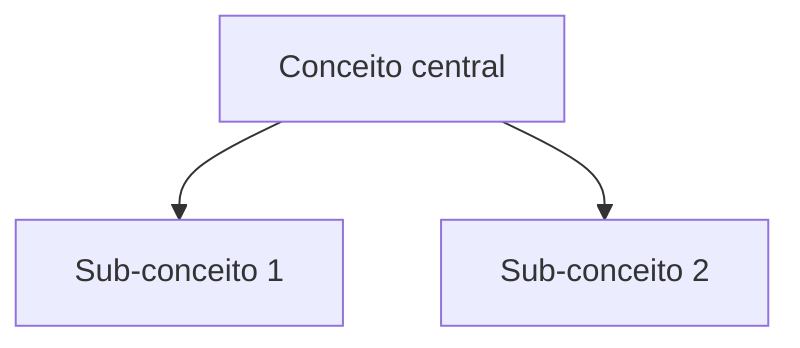

# F2.11 Explainer visual (fontes densas)

Condição de uso: a fonte é densa (paper acadêmico, apostila FIAP `type: study-material`, ou >6000 palavras com densidade técnica alta). Fontes curtas ou simples não disparam. Volta ao procedimento principal em `SKILL.md`, passo 2 (F2.11).

**Princípio**: papers e apostilas são densos. Um diagrama da estrutura conceitual acelera revisão e fixa a relação entre conceitos (insight McAteer: explainer visual antes do entendimento próprio).

## Fluxo

1. Após criar a source page, gerar um bloco Mermaid (`flowchart TD` ou `mindmap`) resumindo a estrutura conceitual da fonte (conceitos-chave + relações).
2. Embutir o bloco na source page sob nova seção `## Explainer`.
3. Opcional: se a skill `json-canvas` estiver disponível, criar `06-GENERATED/explainers/<slug>.canvas` ligando os conceitos principais.

## Template (seção na source page)

```markdown
## Explainer


```

## Regras

- **Mermaid inline preferido** sobre canvas: mais barato, versionável em markdown.
- **Append**: adiciona seção, não reescreve a source page.
